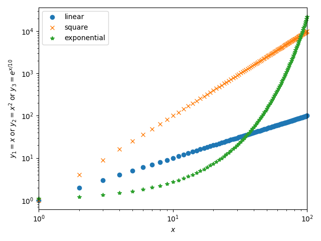

# 実験概要
## 目的

 COMMENT: 資料の内容を要約し，実験の目的をココに記載する
 
## 実験の手順

 COMMENT: 資料の内容を要約し，実験の手順をココに記載する
 
# 実験結果および考察
## パラメータ設定

 COMMENT: 実験で使用したパラメータ設定をココに記載する．パラメータは適宜増やしてよい
 
  | パラメータ                 | 値 |
  |----------------------------|----|
  | 乱数の発生個数 $N$         |    |
  | 一様分布の範囲 $(a, b)$    |    |
  | 指数分布の $\lambda$       |    |
  | パレート分布の $\alpha$    |    |
  | パレート分布の最小値 $x_m$ |    |

## 一様分布

 COMMENT: 各図の説明と，それから分かること，考察を文章で記載する．
 
 
 
*図1: サンプル*
 
## 指数分布

## パレート分布

