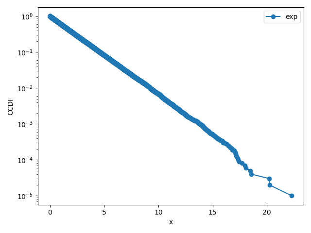
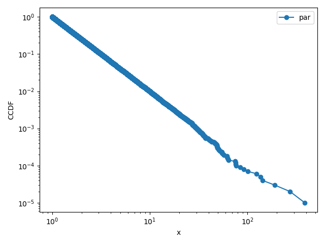
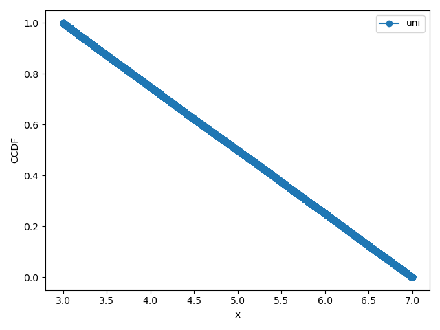

# 実験概要
## 目的

一様分布に従う乱数を用いて、逆関数法により一様分布、指数分布、パレート分布に従う乱数を生成する方法を学ぶ。また、生成した乱数を小さい順に並べ、補分布を対数グラフで表示することで、乱数が目的の確率分布に従っているかを確認する。
 
## 実験の手順

まず、random.random()を用いて区間(0,1)の一様乱数を生成し、逆関数法によって各確率分布に従う乱数を生成するプログラムを作成する。乱数の発生個数Nと分布の種類を指定し、生成した乱数を出力する。
次に、生成したN個の乱数を小さい順に並べ、各乱数x_iに対して補分布の値1-i/Nを求める。これらの値をグラフに描画し、対数目盛を用いて分布の特徴を確認する。さらに、指数分布ではパラメータlambdaを変化させ、乱数の平均値が理論値1/lambdaと一致するかを確認する。
 
# 実験結果および考察
## パラメータ設定

 COMMENT: 実験で使用したパラメータ設定をココに記載する．パラメータは適宜増やしてよい
 
  | パラメータ                 | 値 |
  |----------------------------|----|
  | 乱数の発生個数 $N$         |  10  |
  | 一様分布の範囲 $(a, b)$    |  (3,7)  |
  | 指数分布の $\lambda$       |  0.5  |
  | パレート分布の $\alpha$    |  2  |
  | パレート分布の最小値 $x_m$ |  1  |

## 一様分布

3つのグラフは全て右肩下がりのグラフとなった。通常目盛での比較とした。
横軸が大きくなると収束が弱くなっていった。
 
 
## 指数分布

横軸は通常目盛、縦軸に指数目盛を取った。概観は一様分布と同じようなものになった。

## パレート分布

横軸縦軸ともに指数目盛を取った。概観はほぼ均等な直線に収束したといっていいと思う。