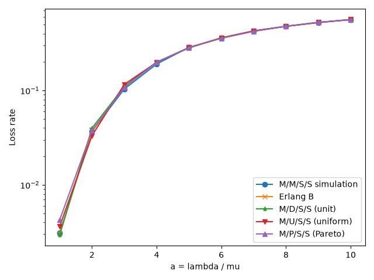

# 実験概要

## 目的

M/M/S/S のシミュレーションを行い、客の到着率とサーバ数によってロス率がどのように変化するかを調べる。また、シミュレーションで求めたロス率とアーランB式による理論値を比較し、結果が一致するかを確認する。

さらに、サービス時間の分布を一定分布、一様分布、パレート分布に変更した M/G/S/S のシミュレーションを行う。平均サービス時間を同じにした場合に、サービス時間のばらつきがロス率に与える影響を調べる。

## 実験の手順

まず、到着間隔を平均 (1/\lambda) の指数分布から生成し、客の到着時刻を求める。客が到着したとき、利用終了時刻が到着時刻より前になっているサーバを探す。空いているサーバがあれば客を割り当て、サービス時間を加えて利用終了時刻を更新する。空いているサーバがなければ、その客は利用できず、ロスとして数える。

すべての客の到着について同じ処理を繰り返し、ロスした客数を到着した客数で割ってロス率を求める。

次に、アーランB式を漸化式で計算し、M/M/S/S のシミュレーション結果と比較する。また、サービス時間の分布を一定分布、一様分布、パレート分布に変更して同様のシミュレーションを行い、ロス率を比較する。

# 実験結果および考察

## パラメータ設定

| パラメータ | 値 |
|---|---:|
| サーバ数 (S) | 5 |
| シミュレーション終了時間 (t_{end}) | 10000 |
| サービス率 \(\mu\) | 1 |
| 負荷 \(a=\lambda/\mu\) | 1～10 |
| 到着率 \(\lambda\) | 1～10 |
| 平均サービス時間 | \(1/\mu=1\) |

サービス時間の分布は、次の4種類とした。

| 分布 | 設定 |
|---|---|
| 指数分布 (M) | 平均 \(1/\mu\) の指数分布 |
| 一定分布 (D) | 常に \(1/\mu\) |
| 一様分布 (U) | \(0\) から \(2/\mu\) の一様分布 |
| パレート分布 (P) | 形状母数 \(\alpha=2.1\)、平均 \(1/\mu\) となるように設定 |

## 結果

以下に、サーバ数を5、終了時間を10000とした場合のロス率を示す。横軸は負荷 \(a=\lambda/\mu\)、縦軸はロス率である。M/M/S/S のシミュレーション結果をアーランB式の理論値と比較し、さらにサービス時間の分布を変更した場合の結果を示した。

負荷 \(a\) が大きくなるほど、サーバが使用中である確率が高くなるため、ロス率も大きくなる。また、M/M/S/S のシミュレーション結果は、アーランB式による理論値におおむね近い値となる。

サービス時間の分布を一定分布、一様分布、パレート分布に変更した場合も、平均サービス時間はすべて同じにしている。シミュレーション結果を比較すると、サービス時間のばらつきが異なっていても、ロス率に大きな差は見られない。これは、到着がポアソン過程である損失系 M/G/S/S では、ロス率がサービス時間の分布の形ではなく平均サービス時間に依存するという性質による。

## 考察

M/M/S/S のシミュレーション結果とアーランB式の理論値が近いことから、今回のプログラムでロス率を求める処理が適切に行われていると考えられる。完全に一致しない部分は、乱数を用いた有限時間のシミュレーションによるばらつきと考えられる。

また、サービス時間の分布を変えても平均サービス時間が同じであれば、ロス率はほぼ変化しないことが分かった。このことから、M/G/S/S のロス率はサービス時間のばらつきの大きさには左右されず、平均サービス時間が重要であると考えられる。
